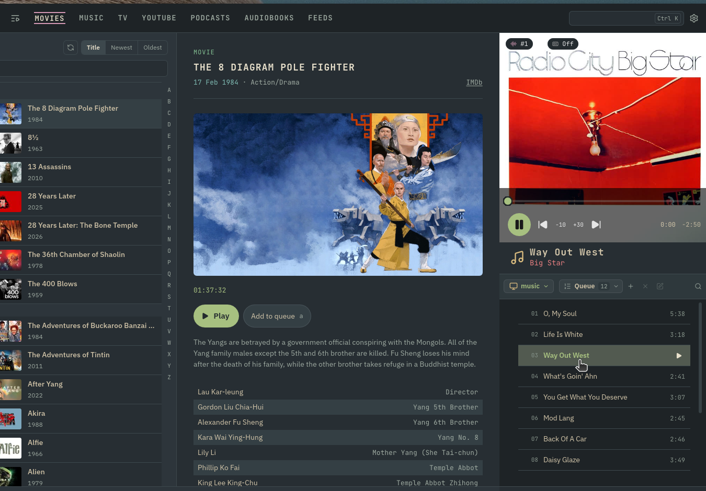
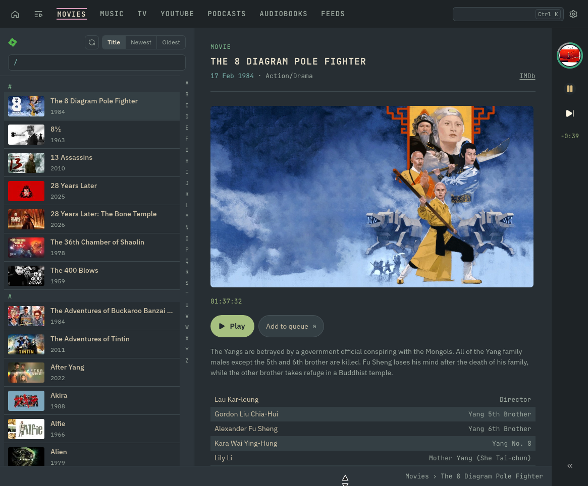

## mbv

`mbv` is an mpv front-end: a Rust native window (Dioxus Native/Blitz) that shows your Emby / Audiobookshelf / RSS-feed libraries and plays and syncs them through mpv in a child process. `mbv-tui` is the same thing as a terminal UI.

Full Emby client session remote control via WebSocket is also supported. `mbv` can control (and be remote-controlled by) standard Emby clients.

`mbvd` uses Emby client protocols to act as a headless server that can be reached over the network; I use it on a small machine attached to my stereo amp like it was mbd but serving from my Emby library. 

You can download it. It's a vibe-coded funtime hobby though, as should be obvious. And I probably have ADHD. I don't even care enough about licencing to type "MIT" on this! Danger.

Services supported: Emby, Audiobookshelf, media RSS feeds.

It requires mpv, obviously.

### Instructions
You turn it on and put in some stuff and there it is.

Building from source for your own machine? `RUSTFLAGS="-C target-cpu=native" cargo build --release` tunes to your CPU instead.

### What's broken
Presumably a lot of stuff.
